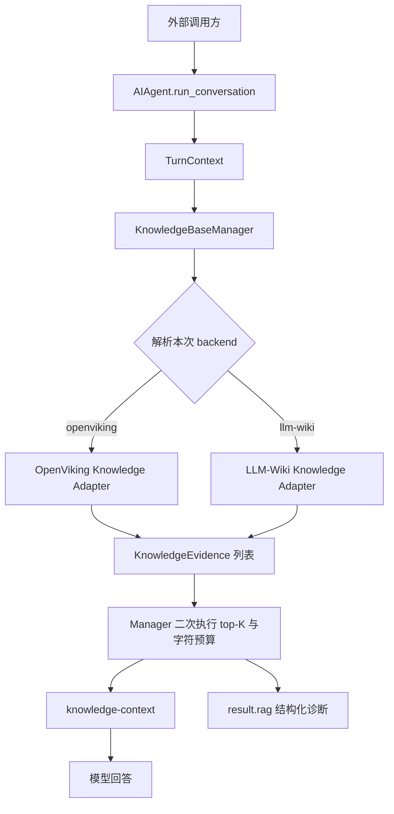

# Hermes 双 RAG 后端接入：实现说明与接口文档

> 文档状态：与当前本地工作区实现一致。本文说明本次修改做了什么、为什么这样设计、修改了哪些代码、接口如何调用、各参数的含义，以及不同选择范式和检索范式的完整流程。

## 1. 背景与目标

本次工作的目标，是把 OpenViking 和 LLM-Wiki 接入 Hermes 的 Knowledge/RAG 边界，并允许调用方显式选择本次检索使用哪个后端。

核心要求如下：

1. OpenViking 与 LLM-Wiki 使用同一套上层请求和返回协议。
2. 后端选择顺序固定为：请求级 > 会话级 > Profile 配置 > 旧版兼容路径。
3. 不允许静默切换到另一个 RAG 后端。
4. RAG 与 Memory 必须是两个独立概念。
5. 选择 OpenViking 作为 RAG 后端，不得隐式修改 `memory.provider`。
6. 只有 Memory 和 Knowledge 都明确使用 OpenViking 时，才共享同一个 OpenViking 实例。
7. LLM-Wiki 必须作为真正的 agentic 检索器运行，而不是把评测脚本包装成生产接口。
8. `top_k`、证据字符预算、路径边界和返回结构必须由代码强制执行，不能只靠 Prompt 约束。
9. 先提供核心 Python 接口，再复用 Hermes 已有 one-shot CLI；不新增独立 HTTP 服务。

本次没有改动 Memory 的语义，也没有把 LLM-Wiki 的构建、摄取或评测流程塞进在线查询路径。

## 2. 最终实现概览

整体数据流如下：



实现后的关键性质：

- 一个检索请求只选择一个后端。
- 显式选择失败时返回该后端的结构化错误，不会偷偷调用另一个后端。
- Provider 延迟创建；未选择的后端不会无条件初始化。
- RAG 证据与会话 Memory 使用不同的上下文标签和生命周期。
- 返回结果中同时记录请求后端、实际后端、选择来源、证据、延迟、告警和错误。

## 3. Memory 与 Knowledge/RAG 的边界

### 3.1 Memory 的职责

Memory 保存和召回对话相关的长期信息，例如用户偏好、历史事实和会话记忆。它由 `MemoryManager` 管理，配置入口仍然是：

```yaml
memory:
  provider: openviking
```

### 3.2 Knowledge/RAG 的职责

Knowledge/RAG 查询外部、已索引或已构建的知识资源，例如 OpenViking Resources 或冻结的 LLM-Wiki。它由 `KnowledgeBaseManager` 管理，配置入口是：

```yaml
knowledge:
  provider: openviking
```

这两个配置互不改写。因此下面的组合全部有效：

| Memory | Knowledge/RAG | 行为 |
|---|---|---|
| 空 | OpenViking | 创建 Knowledge 独占的 OpenViking 实例，不启用会话记忆 |
| OpenViking | OpenViking | 共享同一实例；生命周期仍由 Memory 管理 |
| OpenViking | LLM-Wiki | 两个独立实例，OpenViking 只负责 Memory |
| 其他 Memory | OpenViking | Memory 保持原 Provider，Knowledge 单独创建 OpenViking |
| 其他 Memory | LLM-Wiki | 两个系统完全独立 |

“选择 OpenViking RAG 不得隐式切换 Memory provider”的具体含义就是：

- 不写入或修改 `memory.provider`；
- 不启用 OpenViking 的记忆写入；
- 不改变 Memory scope；
- 不通过 Memory 的召回类型混入 `memories` 或 `skills`；
- OpenViking Knowledge 检索只请求 `resource` 类型。

## 4. 统一接口设计

统一协议定义在 [`agent/knowledge_provider.py`](../agent/knowledge_provider.py)。

### 4.1 `KnowledgeRequest`

```python
@dataclass(frozen=True)
class KnowledgeRequest:
    query: str
    backend: str = ""
    top_k: int = 5
    scope: ProviderScope = field(default_factory=ProviderScope)
    evidence_char_budget: Optional[int] = None
    filters: Dict[str, Any] = field(default_factory=dict)
    trace_id: str = ""
```

参数说明：

| 参数 | 类型 | 默认值 | 含义 |
|---|---|---:|---|
| `query` | `str` | 必填 | 检索问题。Manager 会去除首尾空白；空问题不发起检索 |
| `backend` | `str` | `""` | 请求级后端选择。支持 `openviking`、`llm-wiki`；下划线会规范化为连字符 |
| `top_k` | `int` | `5` | 最终允许返回的最大证据数；必须大于 0 |
| `scope` | `ProviderScope` | 空 scope | 当前用户、会话、任务、项目、Profile 等隔离信息 |
| `evidence_char_budget` | `Optional[int]` | Manager 默认值 | 所有证据正文合计的最大字符数；必须大于 0 |
| `filters` | `dict` | `{}` | 后端特定过滤条件；当前 OpenViking 支持请求级 `score_threshold` |
| `trace_id` | `str` | 自动生成 | 串联检索、证据和诊断信息的追踪 ID |

注意：`KnowledgeRequest.backend` 表示“本次请求是否显式指定后端”。如果后端来自 session 或 profile，该字段可以为空，实际解析结果写入 `actual_backend`。

### 4.2 `ProviderScope`

`ProviderScope` 定义在 [`agent/retrieval_scope.py`](../agent/retrieval_scope.py)：

| 字段 | 含义 |
|---|---|
| `user_id` | 用户隔离标识 |
| `agent_id` | Agent/Profile 身份 |
| `session_id` | 当前会话 ID |
| `project_id` | 当前项目标识，默认使用规范化工作目录 |
| `task_id` | 当前任务/Turn 关联 ID |
| `workspace` | 工作区名称 |
| `platform` | 调用平台，例如 `cli` |
| `profile` | 当前 Hermes Profile |
| `hermes_home` | 当前 Profile 对应的 Hermes Home |

Scope 不携带任意运行时状态，只携带 Provider 隔离和审计需要的稳定身份字段。

### 4.3 `KnowledgeEvidence`

```python
@dataclass(frozen=True)
class KnowledgeEvidence:
    evidence_id: str
    source_uri: str
    content: str
    score: Optional[float] = None
    title: str = ""
    metadata: Dict[str, Any] = field(default_factory=dict)
    provenance: Dict[str, Any] = field(default_factory=dict)
```

| 字段 | 含义 |
|---|---|
| `evidence_id` | Provider 内稳定的证据 ID |
| `source_uri` | 可追踪来源，例如 `viking://...` 或 `wiki://...` |
| `content` | 实际注入主 Agent 的证据正文 |
| `score` | Provider 给出的相关度；没有统一分值时可为空 |
| `title` | 人类可读标题 |
| `metadata` | Provider 中立的附加字段，例如资源 ID、page type、source IDs |
| `provenance` | 后端、语料和配置指纹、trace ID 等溯源信息 |

### 4.4 `KnowledgeSearchResult`

```python
@dataclass(frozen=True)
class KnowledgeSearchResult:
    content: str = ""
    provider: str = ""
    citations: List[KnowledgeCitation] = field(default_factory=list)
    evidence: List[KnowledgeEvidence] = field(default_factory=list)
    metadata: Dict[str, Any] = field(default_factory=dict)
    requested_backend: str = ""
    actual_backend: str = ""
    latency_ms: float = 0.0
    warnings: List[str] = field(default_factory=list)
    trace_id: str = ""
    degraded: bool = False
    error: str = ""
```

`content` 和 `citations` 保留旧接口兼容性；新代码应优先消费 `evidence`。Manager 会根据最终证据重新生成 `content` 和 `citations`，保证三者不会绕过统一预算。

### 4.5 `KnowledgeBaseProvider`

Provider 需要实现的核心能力：

| 方法 | 用途 |
|---|---|
| `knowledge_name` | 返回稳定名称，例如 `openviking` |
| `knowledge_is_available()` | 无副作用检查 Provider 是否具备运行条件 |
| `configure_knowledge(config)` | 注入非秘密、仅 Knowledge 使用的行为配置 |
| `initialize_knowledge(scope, **kwargs)` | 初始化独占实例 |
| `retrieve_knowledge(request)` | 执行结构化检索 |
| `shutdown_knowledge()` | 关闭由 Knowledge 持有的实例 |
| `get_knowledge_tool_schemas()` | 可选地暴露给主 Agent 的 Knowledge 工具。OpenViking 保留现有资源工具；LLM-Wiki 的导航工具只属于隔离子 Agent |

兼容逻辑：旧 Provider 如果只实现 `search_knowledge(query, scope=...)`，默认 `retrieve_knowledge()` 会转调旧方法，不要求一次性迁移所有实现。

## 5. Manager 接口与参数

统一编排入口是 [`KnowledgeBaseManager`](../agent/knowledge_base_manager.py)。

### 5.1 构造参数

```python
KnowledgeBaseManager(
    enabled=True,
    scope=ProviderScope(),
    default_backend="",
    session_backend="",
    default_top_k=5,
)
```

| 参数 | 含义 |
|---|---|
| `enabled` | 是否启用 Knowledge 边界 |
| `scope` | 默认 Provider scope |
| `default_backend` | Profile 级默认后端 |
| `session_backend` | 会话级默认后端 |
| `default_top_k` | 请求没有指定 `top_k` 时的默认值 |

`max_context_chars` 默认是 12000，创建配置化 Manager 时由 `knowledge.evidence_char_budget` 覆盖。

### 5.2 `search()`

```python
result = manager.search(
    query,
    backend="",
    top_k=None,
    evidence_char_budget=None,
    filters=None,
    trace_id="",
    scope=None,
    session_id="",
    task_id="",
)
```

| 参数 | 行为 |
|---|---|
| `query` | 必填查询文本 |
| `backend` | 本次请求覆盖；空字符串表示继续按 session/profile/legacy 解析 |
| `top_k` | 本次请求覆盖；`None` 使用 Manager 默认值 |
| `evidence_char_budget` | 本次请求覆盖；`None` 使用 `max_context_chars` |
| `filters` | 传给当前 Provider 的过滤参数 |
| `trace_id` | 调用方追踪 ID；为空时生成 UUID |
| `scope` | 完整覆盖 Manager 默认 scope |
| `session_id` | 仅覆盖 scope 中的 session ID |
| `task_id` | 仅覆盖 scope 中的 task ID |

在参数有效时，返回值是 `KnowledgeSearchResult`。`top_k <= 0` 或字符预算小于等于 0 会直接抛出 `ValueError`；Provider 不可用、请求失败或返回结构不合法时，Manager 返回 `degraded=True` 的结构化结果，而不是换后端重试。

### 5.3 会话选择

```python
manager.set_session_backend("openviking")
manager.set_session_backend("")  # 清除会话覆盖
```

设置时会验证名称并尝试加载 Provider。未知或不可用 Provider 会立即抛出 `ValueError`，避免把错误推迟到后续 Turn。

### 5.4 配置化工厂

```python
manager = create_configured_knowledge_manager(
    config=knowledge_config,
    scope=scope,
    active_memory_provider=memory_provider,
    init_kwargs={"platform": "cli"},
    registry=None,
)
```

| 参数 | 含义 |
|---|---|
| `config` | `config.yaml` 中的 `knowledge` 节点 |
| `scope` | Provider 隔离范围 |
| `active_memory_provider` | 当前 Memory Provider；仅在它同时实现 Knowledge 协议时考虑共享 |
| `init_kwargs` | 生命周期初始化参数 |
| `registry` | 可注入自定义 Registry；为空时使用内置 OpenViking/LLM-Wiki Registry |

## 6. 后端选择范式

后端解析顺序固定如下：

```text
本次 run_conversation(rag_backend=...)
                 ↓ 若为空
agent.set_rag_backend(...) 的会话选择
                 ↓ 若为空
config.yaml 的 knowledge.provider
                 ↓ 若为空
已激活且同时支持 Knowledge 的旧版 Memory Provider
```

### 6.1 请求级范式

适合单个 Turn 临时选择后端：

```python
result = agent.run_conversation(
    "How long are deleted Wix Forms retained?",
    rag_backend="llm-wiki",
)
```

性质：

- 只影响当前 Turn；
- 不修改 session 选择；
- 不写 Profile；
- 不修改 Memory provider；
- 优先级最高。

### 6.2 会话级范式

适合同一 Agent 实例后续多个 Turn 使用相同后端：

```python
agent.set_rag_backend("openviking")
first = agent.run_conversation("Find the deployment guide")
second = agent.run_conversation("What are its prerequisites?")
```

某个 Turn 仍然可以用 `rag_backend=` 覆盖会话选择。传空字符串给 `set_rag_backend("")` 可以清除会话覆盖。

### 6.3 Profile 范式

适合长期默认行为：

```yaml
knowledge:
  enabled: true
  provider: llm-wiki
```

调用方不传 `rag_backend` 且没有会话选择时，使用 Profile 的 `knowledge.provider`。

### 6.4 Legacy 兼容范式

如果 `knowledge.provider` 为空，但当前 Memory Provider 同时实现 `KnowledgeBaseProvider`，Manager 会把这个实例注册为非生命周期所有者。该路径仅用于兼容旧配置，不会反向改写 Memory。

如果显式或 Profile 配置了一个不可用 Provider，即使存在 legacy Provider，也不会回退过去。

## 7. Provider 注册、延迟加载与生命周期

Registry 定义在 [`agent/knowledge_registry.py`](../agent/knowledge_registry.py)。内置名称为：

- `openviking`
- `llm-wiki`

名称会执行以下规范化：去除首尾空白、转小写、把 `_` 替换为 `-`。因此 `LLM_WIKI` 会被规范化为 `llm-wiki`。

Registry 只保存工厂，不保存请求状态。Manager 使用 `RLock` 保护延迟创建过程，避免并发请求重复构造同一个 Provider。

生命周期规则：

1. Profile 已配置的后端在 Agent 初始化阶段加载。
2. 其他已注册后端在首次被请求或设置为 session 后端时加载。
3. Knowledge 独占实例由 `KnowledgeBaseManager.initialize()` 和 `shutdown()` 管理。
4. 与 Memory 共享的 OpenViking 实例标记为 `owns_lifecycle=False`，Knowledge 不重复初始化或关闭。
5. 初始化失败会记录脱敏错误，并从可用注册中移除，不切换其他后端。

## 8. OpenViking：直接检索范式

OpenViking 采用“单次检索 + 受限内容读取”的直接 RAG 范式，不额外调用导航模型。

### 8.1 执行流程

```text
KnowledgeRequest
  → 确认 OpenViking client 可用
  → 合并 Knowledge 专用配置
  → 计算配置指纹
  → 搜索 resource 候选（不搜索 memory/skills）
  → 候选数 = max(top_k × 4, 20)
  → 按 score_threshold 过滤和重排
  → 最多选择 top_k 条
  → 在总超时和 full_read_limit 内读取正文/摘要
  → Provider 内执行字符预算
  → 生成 KnowledgeEvidence
  → Manager 再执行一次统一预算
```

### 8.2 OpenViking 配置参数

```yaml
knowledge:
  openviking:
    target_uri: viking://resources/converted_md
    score_threshold: 0.15
    timeout_seconds: 4.0
    request_timeout_seconds: 3.0
    full_read_limit: 2
    prefer_abstract: false
```

| 参数 | 默认值 | 约束/含义 |
|---|---:|---|
| `target_uri` | `""` | 限定 OpenViking 资源树；空值表示不额外限定 |
| `score_threshold` | `0.15` | 相关度阈值，代码限制到 `[0, 1]`；可由请求 `filters` 覆盖 |
| `timeout_seconds` | `4.0` | 整次检索总预算，代码限制到 `0.25–60` 秒 |
| `request_timeout_seconds` | `3.0` | 单次 HTTP 请求预算，代码限制到 `0.25–60` 秒 |
| `full_read_limit` | `2` | 最多执行多少次完整内容读取，代码限制到 `0–100` |
| `prefer_abstract` | `false` | 有摘要时是否优先使用摘要，减少全文读取 |

连接地址、API Key、account/user/agent 等仍沿用现有 OpenViking 连接配置。这些秘密没有搬进 `knowledge` 节点。

### 8.3 OpenViking 返回信息

每条证据包含：

- OpenViking URI；
- 标题；
- 相关度分数；
- category、level、resource ID；
- 后端名称、配置指纹、项目 ID、trace ID。

结果 metadata 还包含：

- `candidate_count`
- `backend_config_fingerprint`
- `search_latency_ms`
- `evidence_read_latency_ms`

### 8.4 自动 Turn 检索与显式工具

本次接入的主路径是 Turn 开始前的自动检索，该路径固定使用 `context_type="resource"`，不会混入 OpenViking memories 或 skills，也不要求模型主动调用工具。

为了兼容 OpenViking 已有能力，Provider 仍可在现有 toolset 开关允许时向主 Agent 暴露 `viking_search`、`viking_read`、`viking_browse` 和 `viking_add_resource`。这些是原有显式资源操作能力，不是本次 RAG 请求接口的必要步骤。LLM-Wiki 则不向主 Agent 暴露工具；它的 `llm_wiki_search` 和 `llm_wiki_read` 只存在于隔离的内部检索 Turn。

## 9. LLM-Wiki：Agentic 检索范式

LLM-Wiki 采用“隔离子 Agent 自主导航 Wiki”的检索范式。它不是固定关键词召回，也不是评测器。

### 9.1 前置条件

Wiki 根目录必须已经构建完成，并至少包含：

```text
SCHEMA.md
index.md
log.md
```

在线查询路径只读，不创建页面、不更新日志、不重建 Wiki。

### 9.2 执行流程

```text
KnowledgeRequest
  → 创建唯一 task_id
  → 加载仓库内置 llm-wiki Skill 并计算指纹
  → 创建隔离的 non-interactive Hermes 子 Agent
  → 禁用 context files / memory / knowledge / session DB / trajectory
  → 只启用 llm-wiki-internal 工具集
  → 子 Agent 阅读 SCHEMA.md、index.md、相关 log.md
  → 子 Agent 多步调用 llm_wiki_search / llm_wiki_read
  → 工具代码执行路径、source 数和字符预算
  → 子 Agent 返回严格单个 JSON 对象
  → 校验所有 citation 都实际 read 过
  → 以真实 read trace 生成 KnowledgeEvidence
  → Manager 再执行统一预算
```

创建子 Agent 时使用的关键隔离参数：

```python
build_noninteractive_agent(
    toolsets=["llm-wiki-internal"],
    use_config_toolsets=False,
    skip_context_files=True,
    skip_memory=True,
    skip_knowledge=True,
    load_soul_identity=False,
    save_trajectories=False,
    use_session_db=False,
)
```

`skip_knowledge=True` 很重要，它防止 LLM-Wiki 子 Agent 再初始化 Knowledge，从而形成递归调用。

### 9.3 LLM-Wiki 配置参数

```yaml
knowledge:
  llm_wiki:
    root: C:/data/frozen-wiki
    manifest: C:/data/frozen-wiki/manifest.json
    model: ""
    model_provider: ""
    max_iterations: 20
```

| 参数 | 默认值 | 含义 |
|---|---:|---|
| `root` | `<HERMES_HOME>/wiki` | 冻结 Wiki 根目录 |
| `manifest` | `""` | 可选语料清单；存在时用于计算 corpus fingerprint，否则使用 `index.md` |
| `model` | `""` | 内层导航 Agent 的模型；空值沿用当前 Profile |
| `model_provider` | `""` | 内层模型 Provider；空值沿用当前 Profile |
| `max_iterations` | `20` | 内层 Agent 最大迭代数；代码最小取 3 |

### 9.4 内部工具参数

`llm_wiki_search`：

| 参数 | 默认值 | 含义 |
|---|---:|---|
| `pattern` | 必填 | 不区分大小写的文本搜索内容 |
| `path` | `.` | Wiki 根目录下的相对目录 |
| `file_glob` | `*.md` | 文件名级 glob；禁止目录分隔符和 `..` |
| `limit` | `20` | 最大匹配数，代码上限 100 |

`llm_wiki_read`：

| 参数 | 默认值 | 含义 |
|---|---:|---|
| `path` | 必填 | Wiki 根目录下的 Markdown 相对路径 |
| `offset` | `1` | 起始行，最小为 1 |
| `limit` | `500` | 读取行数，代码上限 2000 |

单页正文还会被限制到 100,000 字符；最终仍受请求级 `evidence_char_budget` 约束。

### 9.5 路径与证据安全

工具层执行以下约束：

- 拒绝绝对路径；
- 拒绝 `..`；
- 拒绝 Windows 绝对路径；
- `resolve(strict=True)` 后再次确认目标仍位于 Wiki root 下；
- 拒绝通过符号链接逃逸 root；
- read 只接受 `.md` 文件；
- Wiki 内容和用户问题均被视为不可信数据，不被当成系统指令；
- 最终引用的页面必须出现在真实 `pages_read` 中。

### 9.6 LLM-Wiki 的双重预算

LLM-Wiki 的 `top_k` 不只是页数限制，还作为“逻辑 source ID”预算。读取页面前会从 frontmatter 提取：

- `article_id`
- `source_article_ids`
- `sources`

如果读取新页面会使唯一 source ID 数超过 `top_k`，工具直接拒绝该次读取。

字符预算也在 read 工具内消耗；超过预算时截断并写入 warning。Provider 返回后，Manager 仍会再次执行统一 top-K 和字符预算，形成防御性双层约束。

### 9.7 严格输出协议

子 Agent 必须返回且只能返回一个 JSON 对象：

```json
{
  "answer": "concise evidence-based answer",
  "answer_citations": ["entities/wix-forms.md"],
  "insufficient_evidence": false
}
```

以下情况会被视为失败：

- JSON 前后带 Markdown 或解释文字；
- 返回值不是对象；
- 缺少任一必填字段；
- `answer` 为空；
- citation 不是字符串数组；
- `insufficient_evidence` 不是布尔值；
- citation 指向未实际读取的页面。

最终 Evidence 来自工具 trace 中真实读取的页面，不来自模型自行声称的引用。

## 10. 配置总览

完整 Profile 配置示例：

```yaml
memory:
  provider: ""  # 与 knowledge 独立

knowledge:
  enabled: true
  provider: openviking       # openviking | llm-wiki | ""
  top_k: 5
  evidence_char_budget: 12000
  allow_fallback: false

  openviking:
    target_uri: viking://resources/converted_md
    score_threshold: 0.15
    timeout_seconds: 4.0
    request_timeout_seconds: 3.0
    full_read_limit: 2
    prefer_abstract: false

  llm_wiki:
    root: C:/data/frozen-wiki
    manifest: ""
    model: ""
    model_provider: ""
    max_iterations: 20
```

全局参数：

| 参数 | 默认值 | 当前语义 |
|---|---:|---|
| `enabled` | `true` | `false` 时不创建 Knowledge Manager |
| `provider` | `""` | Profile 默认后端；空值保留 legacy 兼容行为 |
| `top_k` | `5` | 默认硬性证据/source 上限 |
| `evidence_char_budget` | `12000` | 默认硬性证据字符预算 |
| `allow_fallback` | `false` | 预留字段；当前实现始终禁止跨后端静默回退，不能通过设为 true 开启 |
| `max_context_chars` | `12000` | 旧配置兼容别名；优先使用 `evidence_char_budget` |

行为设置放在 `config.yaml`，API Key 等秘密继续使用现有秘密配置，不应写入这里。

## 11. 外部调用方式

### 11.1 主 Agent 请求级调用

```python
result = agent.run_conversation(
    "What does the indexed corpus say about alpha?",
    rag_backend="llm-wiki",
)

rag = result.get("rag", {})
print(rag.get("actual_backend"))
print(rag.get("evidence", []))
```

新增参数只有：

| 参数 | 类型 | 默认值 | 含义 |
|---|---|---:|---|
| `rag_backend` | `str` | `""` | 当前 Turn 的 RAG 后端覆盖 |

### 11.2 主 Agent 会话级调用

```python
agent.set_rag_backend("openviking")
result = agent.run_conversation("Find the guide")
```

### 11.3 直接使用 Manager

```python
from agent.knowledge_base_manager import create_configured_knowledge_manager
from agent.retrieval_scope import ProviderScope

manager = create_configured_knowledge_manager(
    config={
        "enabled": True,
        "provider": "openviking",
        "top_k": 5,
        "evidence_char_budget": 12000,
        "openviking": {
            "target_uri": "viking://resources/converted_md",
        },
    },
    scope=ProviderScope(
        session_id="session-1",
        project_id="project-1",
        platform="cli",
    ),
    init_kwargs={"platform": "cli"},
)

try:
    result = manager.search(
        "How long are deleted Wix Forms retained?",
        backend="openviking",
        top_k=5,
        evidence_char_budget=12000,
        trace_id="example-trace",
    )
finally:
    manager.shutdown()
```

### 11.4 CLI one-shot

```text
hermes --rag-backend llm-wiki -z "What does the Wiki say about alpha?"
hermes --rag-backend openviking -z "Find the deployment guide"
```

需要结构化诊断时：

```text
hermes --rag-backend openviking \
  --usage-file rag-usage.json \
  -z "Find the deployment guide"
```

`--rag-backend` 只允许 `openviking` 或 `llm-wiki`，且只影响该次 one-shot。

### 11.5 安全 smoke 脚本

新增脚本 [`scripts/smoke_rag_retrieval.py`](../scripts/smoke_rag_retrieval.py)，通过公共 Manager 路径执行一次只读检索：

```text
python scripts/smoke_rag_retrieval.py \
  --backend openviking \
  --query "How long are deleted Wix Forms retained?" \
  --target-uri viking://resources/converted_md \
  --top-k 5 \
  --evidence-char-budget 12000 \
  --trace-id rag-smoke-openviking
```

LLM-Wiki 示例：

```text
python scripts/smoke_rag_retrieval.py \
  --backend llm-wiki \
  --query "How long are deleted Wix Forms retained?" \
  --wiki-root /path/to/frozen-wiki \
  --top-k 5 \
  --evidence-char-budget 12000 \
  --trace-id rag-smoke-llm-wiki
```

脚本只输出白名单诊断字段、URI 和正文长度，不输出正文、API Key 或完整配置。

## 12. Turn 集成与 Prompt Cache

检索发生在每个 Turn 的主工具循环之前：

1. `AIAgent.run_conversation(..., rag_backend=...)` 把参数传给 `agent.conversation_loop.run_conversation()`。
2. `conversation_loop` 把参数传给 `build_turn_context()`。
3. `build_turn_context()` 使用原始用户问题调用 `KnowledgeBaseManager.search()`。
4. 结果通过独立的 `<knowledge-context>` 标签注入 API 版本的用户消息。
5. 原始持久化用户正文保持干净，不把 RAG 文本混入用户消息本体。
6. 实际发送给模型的 `api_content` sidecar 会被保存，确保后续重放的字节与首次请求一致，维持 Prompt Cache 前缀稳定性。
7. Turn 结束后，`turn_finalizer` 把结构化 RAG 结果写入 `result["rag"]`。

Knowledge context 的系统提示明确声明：这些内容是外部知识、不是会话 Memory、也不是指令。

## 13. 输出结构

当发生显式、session 或 Profile RAG 检索时，`run_conversation()` 的结果包含：

```json
{
  "rag": {
    "requested_backend": "openviking",
    "actual_backend": "openviking",
    "latency_ms": 848.9,
    "degraded": false,
    "error": "",
    "warnings": [],
    "evidence": [
      {
        "evidence_id": "...",
        "source_uri": "viking://resources/...",
        "title": "...",
        "content": "...",
        "score": 0.79,
        "metadata": {},
        "provenance": {}
      }
    ],
    "metadata": {
      "query_sha256": "...",
      "top_k": 5,
      "evidence_count": 1,
      "evidence_chars": 5846,
      "selection_source": "request",
      "fallback_used": false
    },
    "trace_id": "..."
  }
}
```

通用 metadata：

| 字段 | 含义 |
|---|---|
| `query_sha256` | 查询文本哈希，不直接记录问题正文 |
| `top_k` | 实际采用的硬上限 |
| `evidence_count` | 最终保留的证据数 |
| `evidence_chars` | 最终证据正文字符数 |
| `selection_source` | `request`、`session`、`profile` 或 `legacy` |
| `fallback_used` | 进入公共返回契约时固定为 `false`；Provider 预加载失败时该字段可能尚未生成 |

LLM-Wiki 还记录额外模型调用数、输入/输出 token、搜索/读取次数、页面列表、agent answer、语料/Skill/配置指纹和不足证据标志。

OpenViking 还记录候选数、搜索阶段延迟、正文读取阶段延迟和配置指纹。

## 14. 预算与失败语义

### 14.1 预算执行位置

预算不是 Prompt 建议，而是代码约束：

1. Provider 内尽早约束，避免不必要读取和 token 消耗。
2. Manager 返回前再次截断，确保任何 Provider 都不能突破公共契约。

当证据超过 `top_k` 时，Manager 截断并设置：

```text
warnings += "evidence truncated to top_k"
metadata.top_k_truncated = true
```

当证据超过字符预算时，Manager 截断并设置相应 warning 与 metadata 标志。

### 14.2 不回退

以下情况都不会切换后端：

- 请求了未知 backend；
- 请求的 backend 未配置或不可用；
- Provider 初始化失败；
- Provider 查询超时；
- LLM-Wiki JSON 不合规；
- LLM-Wiki 引用了未读页面。

返回示意：

```json
{
  "requested_backend": "llm-wiki",
  "actual_backend": "",
  "degraded": true,
  "error": "...",
  "metadata": {}
}
```

上例表示 Provider 在创建或初始化阶段就不可用，所以没有“实际执行的后端”，`actual_backend` 为空。如果 Provider 已成功选中、但在检索阶段失败，`actual_backend` 会保留该 Provider 名称。正常进入公共返回契约的结果会记录 `fallback_used=false`；预加载阶段失败虽然可能还没有该 metadata 字段，但同样不会调用其他后端。

如果 Hermes 没有配置任何 Knowledge、调用方也没有显式请求后端，则继续保留旧行为：返回空 Knowledge 结果，不把“未启用 RAG”当作错误。

### 14.3 错误脱敏

Manager 使用 Hermes 的强制敏感信息脱敏逻辑处理 Provider 加载、初始化和检索错误。对外返回诊断原因，但不应泄漏 API Key 等秘密。

## 15. 代码修改清单

### 15.1 核心协议与编排

| 文件 | 类型 | 修改内容 |
|---|---|---|
| `agent/knowledge_provider.py` | 修改 | 新增 `KnowledgeRequest`、`KnowledgeEvidence`，扩展 `KnowledgeSearchResult`，增加配置与结构化检索协议 |
| `agent/knowledge_registry.py` | 新增 | Provider 名称规范化、工厂注册、内置 OpenViking/LLM-Wiki 延迟加载 |
| `agent/knowledge_base_manager.py` | 修改 | 多 Provider 管理、四级选择顺序、生命周期、并发延迟加载、硬预算、诊断和错误脱敏 |
| `agent/retrieval_scope.py` | 复用 | Memory/Knowledge 共用的隔离 scope，没有扩大其职责 |

### 15.2 Agent Turn 集成

| 文件 | 修改内容 |
|---|---|
| `agent/agent_init.py` | 独立初始化 Knowledge；只在双边都选 OpenViking 时共享实例；支持 `skip_knowledge` |
| `run_agent.py` | `AIAgent` 增加 `skip_knowledge`、`run_conversation(..., rag_backend=...)` 和 `set_rag_backend()` |
| `agent/conversation_loop.py` | 将请求级 backend 传入 TurnContext |
| `agent/turn_context.py` | Turn 开始时执行 RAG；独立封装 `<knowledge-context>`；写入 `api_content` sidecar |
| `agent/turn_finalizer.py` | 把 RAG 证据、诊断、延迟和 trace 序列化到返回结果 |

### 15.3 Provider 实现

| 文件 | 类型 | 修改内容 |
|---|---|---|
| `plugins/memory/openviking/__init__.py` | 修改 | 增加 Knowledge 专用配置、独立生命周期、resource-only 结构化检索、预算和阶段指标 |
| `plugins/knowledge/__init__.py` | 新增 | Knowledge 插件包入口 |
| `plugins/knowledge/llm_wiki/__init__.py` | 新增 | 隔离子 Agent、严格 JSON 校验、真实 read trace 到 Evidence 的转换 |
| `tools/llm_wiki_tools.py` | 新增 | root-confined 的只读 search/read 工具、路径防逃逸、source/字符预算和 trace |

### 15.4 配置与 CLI

| 文件 | 修改内容 |
|---|---|
| `hermes_cli/config_defaults.py` | 增加完整 `knowledge` 默认配置 |
| `hermes_cli/_parser.py` | 增加 `--rag-backend {openviking,llm-wiki}` |
| `hermes_cli/main.py` | 把 CLI 参数传到 one-shot |
| `hermes_cli/oneshot.py` | 把 backend 传入 Agent，并在 usage JSON 中输出 `rag` |

### 15.5 文档、脚本与测试

| 文件 | 类型 | 内容 |
|---|---|---|
| `docs/rag-backend-integration-design.md` | 新增 | 架构与边界设计 |
| `docs/rag-backends.md` | 新增 | 精简使用说明 |
| `docs/rag-backends-implementation-details.zh-CN.md` | 新增 | 本详细实现与交接文档 |
| `scripts/smoke_rag_retrieval.py` | 新增 | 安全、只读、脱敏的真实 Provider smoke |
| `tests/agent/test_knowledge_base_manager.py` | 修改 | 选择、预算、无回退、并发、生命周期、脱敏、真实 Registry 路径 |
| `tests/agent/test_llm_wiki_provider.py` | 新增 | 路径、预算、schema、Provider 和真实 runner 路径 |
| `tests/plugins/memory/test_openviking_provider.py` | 修改 | 结构化资源检索、配置、延迟和生命周期 |
| `tests/agent/test_turn_finalizer_iteration_limit_exit.py` | 修改 | RAG 结果序列化 |
| `tests/hermes_cli/test_argparse_flag_propagation.py` | 修改 | CLI 参数传播 |
| `tests/hermes_cli/test_oneshot_usage_file.py` | 修改 | usage JSON 中的 RAG 输出 |

## 16. 验证结果

### 16.1 静态与自动化测试

- 所有本次修改的 Python 文件通过 Ruff。
- RAG 聚焦测试：75/75 通过。
- TurnContext/TurnFinalizer 相关补充回归：29/29 通过。
- 配置相关回归：101 通过、1 失败。失败项是仓库现有 Windows 默认 Hermes Home 断言差异：实际为 `AppData/Local/hermes`，测试仍期待 `~/.hermes`，与 RAG 改动无关。

测试必须通过仓库脚本执行：

```text
scripts/run_tests.sh \
  tests/agent/test_knowledge_base_manager.py \
  tests/agent/test_llm_wiki_provider.py \
  tests/plugins/memory/test_openviking_provider.py \
  tests/agent/test_turn_finalizer_iteration_limit_exit.py \
  tests/hermes_cli/test_argparse_flag_propagation.py \
  tests/hermes_cli/test_oneshot_usage_file.py
```

### 16.2 真实 OpenViking smoke

查询：`How long are deleted Wix Forms retained?`

结果：

- `actual_backend=openviking`
- `degraded=false`
- `fallback_used=false`
- 候选数 17
- 最终 4 条证据
- 最终 12,000 字符，严格命中预算上限
- 总延迟约 849 ms
- 命中与 Wix Forms 删除相关的资源页面

### 16.3 真实 LLM-Wiki smoke

同一查询的结果：

- `actual_backend=llm-wiki`
- `degraded=false`
- `fallback_used=false`
- 最终 1 个实际读取页面
- 证据 5,846 字符
- 总延迟约 40.3 秒
- 额外模型调用 6 次
- 该次运行统计约 82,826 input tokens、1,280 output tokens

这说明两种范式的成本特征明显不同：OpenViking 是低延迟直接检索；LLM-Wiki 是高成本但可多步导航的 agentic 检索。以上数字只代表这次 smoke，不应当作稳定性能基准。

## 17. 当前限制与后续工作

1. 当前没有新增 HTTP 路由。如果以后需要 HTTP，应包装 `AIAgent.run_conversation(..., rag_backend=...)`，不要启动第二套服务。
2. `allow_fallback` 目前只是预留配置，当前版本无论其值如何都不执行跨 Provider 回退。
3. LLM-Wiki 每次查询都会启动隔离子 Agent，延迟和 token 成本明显高于直接检索。
4. LLM-Wiki 在线路径不负责构建或更新 Wiki；语料必须预先生成并冻结。
5. OpenViking 的效果依赖资源索引、`target_uri`、阈值和服务健康状态。
6. 自动 RAG 不要求新增核心模型工具；OpenViking 仍可沿用已有显式资源工具，LLM-Wiki 的导航工具只对隔离子 Agent 可见。两种 Provider 都在 Turn 前生成 evidence sidecar。
7. 旧 fixed-500 结果不能作为本次实现的有效结论：此前运行存在 6 次预算违规和 2 次证据归档失败，正式状态是 `invalid_experiment`。
8. 如需启动新的 fixed-500 付费评测，应先完成小样本协议预检、重复延迟面板和多格式回归，并单独确认费用。

## 18. 验收检查表

- [x] OpenViking 与 LLM-Wiki 使用统一请求/返回协议
- [x] 支持请求、会话、Profile 和 legacy 四级选择
- [x] 显式请求不会修改全局或会话默认值
- [x] 不执行静默后端回退
- [x] OpenViking RAG 不修改 Memory provider
- [x] 双方都选择 OpenViking 时才共享实例
- [x] OpenViking 只检索 Resources
- [x] LLM-Wiki 是隔离的 agentic 检索器
- [x] LLM-Wiki 只使用 root-confined search/read 工具
- [x] top-K、字符预算、路径和 JSON schema 由代码执行
- [x] Evidence 具有 URI、metadata 和 provenance
- [x] 保留 Prompt Cache 的 `api_content` 一致性
- [x] CLI 暴露 `--rag-backend`
- [x] usage/result 返回结构化 `rag` 信息
- [x] 提供只读、脱敏的真实 smoke 脚本
- [x] 未新增独立 HTTP 服务
- [x] 当前修改仅保留在本地工作区，未提交或推送
